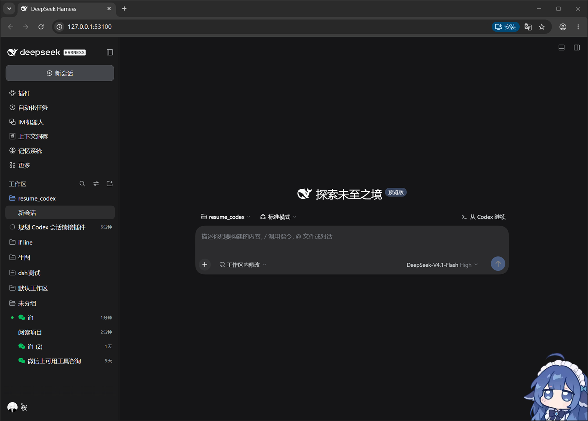
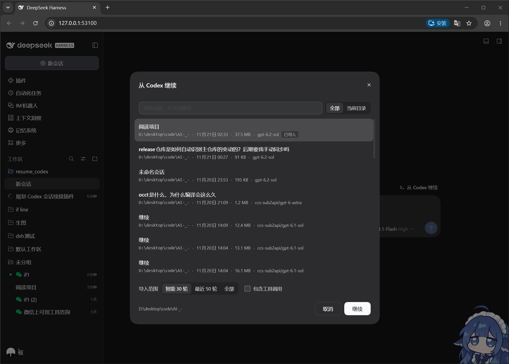

# 从 Codex 继续 · dsh-resume-codex

在 DeepSeek Harness（DSH）的新建会话页加入「从 Codex 继续」：选择一个本机 Codex 会话，把它的对话记录、压缩摘要和工作目录导入成一个新的 DSH 会话，然后直接接着聊。

Codex 文件只读，不会修改，也不会向 Codex 发送任何内容，不消耗 Codex 额度。





## 功能

- 新建会话页样式与 DSH 原生控件一致（28px chip、DSH Modal 的圆角/表面/按钮）。
- 扫描 `$CODEX_HOME`（默认 `~/.codex`）下 `sessions/` 与 `archived_sessions/` 的 rollout。
- 支持搜索、只看当前目录、已导入标记。
- 导入范围：智能 30 轮 / 最近 50 轮 / 全部对话；可选包含工具调用。
- 智能模式使用最近一次 Codex `compacted` 摘要作为压缩前上下文。
- 自动复用或在 Codex 原目录新建工作区，导入后直接打开新会话。
- 过滤 Codex 注入的 fork 边界、`<environment_context>`、`<user_instructions>` 等伪用户消息。

## 安装

要求：DSH Desktop（Web GUI），本机有 Codex 会话目录。

### 方式一：让 DSH 的 Agent 安装（推荐）

把下面这句发给任意 DSH 会话：

```text
plugin_manager install_bundle target="github:lycohana/dsh-resume-codex#v0.1.0"
```

安装完成后在 **插件** 页确认 `dsh-resume-codex` 已启用；建议重启一次 DSH（Host 插件在安装时已加载，重启可确保最新代码）。

### 方式二：插件页添加

在 **插件 → 添加插件** 中粘贴 Git 规格（与上面命令使用同一个安装器）：

```text
github:lycohana/dsh-resume-codex#v0.1.0
```

如果当前版本的添加框只接受本地目录或包名，请使用方式一或方式三。

### 方式三：Release 压缩包

```text
plugin_manager install_bundle target="https://github.com/lycohana/dsh-resume-codex/releases/download/v0.1.0/dsh-resume-codex-0.1.0.tgz"
```

### 更新

```text
plugin_manager install_bundle target="github:lycohana/dsh-resume-codex#v0.2.0"
```

Git 规格按标签或分支安装后，插件页不会显示版本更新；要用新版本请重新安装新的标签。

## 使用

1. 打开「新会话」，点工作区/模式那一行最右端的「从 Codex 继续」。
2. 选择 Codex 会话，选择导入范围与是否包含工具调用。
3. 点「继续」，DSH 会创建并打开新会话。

## 配置

插件行的 `config` 可选设置：

| 键 | 默认值 | 说明 |
|---|---|---|
| `codexHome` | `$CODEX_HOME` 或 `~/.codex` | Codex 数据目录 |
| `maxSessions` | `500` | 列表最多读取的会话数 |
| `maxTurns` | `30` | 智能模式保留的最近轮数 |
| `maxChars` | `240000` | 智能模式的字符预算 |
| `maxFullChars` | `4000000` | 全部模式的字符预算 |
| `maxImportFileBytes` | `67108864` | 单个 rollout 文件大小上限 |
| `toolResultMaxChars` | `12000` | 单条命令输出上限 |

## 限制

- 只导入文本；图片与附件以 `[图片]` / `[文件]` 占位。
- Codex 的加密推理内容（`reasoning`）不会导入。
- 导入后是新会话，独立存在，不跟随 Codex 后续变化。
- 原工作目录不存在时会回退到当前工作区，并在结果里给出警告。

## 开发

```bash
# 本地安装
plugin_manager install_bundle target="D:\\path\\to\\dsh-resume-codex"
# 打包
pnpm pack
```

设计记录见 [dev/PLAN.md](dev/PLAN.md)，插件详情见 [docs/DETAIL.md](docs/DETAIL.md)。

## License

MIT
